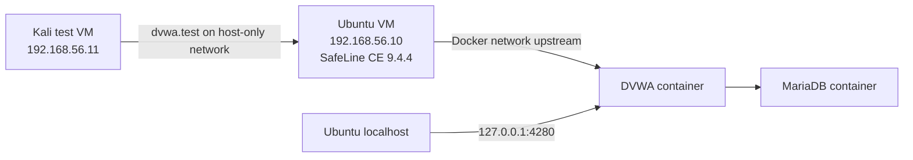

# SafeLine WAF Project: DVWA Traffic Controls

I built this controlled project on two VirtualBox VMs to practice placing a web application firewall in front of a test application, checking normal traffic, and correlating blocked requests with SafeLine events. The scope is local practice and documentation of observed results.

The [redacted observation notes](OBSERVED_RESULTS.md) transcribe the request results from the original screenshots without publishing URL tokens or session cookies.

## Lab layout

The DVWA container is published to Ubuntu's loopback address at `127.0.0.1:4280`, so Kali cannot use `192.168.56.10:4280` to bypass the WAF. Kali reaches the application through `dvwa.test`. The two VMs share a VirtualBox host-only network. The SafeLine and DVWA containers run on Ubuntu; Kali is the test client. The currently saved SafeLine application has **HTTPS 443 only**, as confirmed by reopening its Edit view. Earlier HTTP tests were captured before port 80 was removed.

| Evidence | What it shows |
| --- | --- |
| [Ubuntu address and Docker containers](evidence/01-ubuntu-network-docker.png) | Ubuntu `192.168.56.10/24`, SafeLine containers, DVWA/MariaDB containers, and DVWA's loopback port binding. |
| [Kali address](evidence/02-kali-network.png) | Kali `192.168.56.11/24` on the host-only network. |
| [Current SafeLine application Edit view](evidence/06-safeline-app-https-443.png) | `dvwa.test`, HTTPS 443, selected `dvwa.test` certificate, upstream `http://172.18.0.3`, and health checks. The user confirmed this is the view after reopening the saved application. |

## Tests and observations

| Test | Observed result | Evidence |
| --- | --- | --- |
| Normal DVWA SQL Injection page request with user ID `1` | DVWA displayed one user record (`admin`). | Original screenshot reviewed; a public copy needs its URL token removed. |
| Sample SQL injection string entered in DVWA | SafeLine displayed an Access Forbidden page; its attack log recorded a blocked `SQL Inj` request from Kali. | Original block page and attack-log screenshots reviewed; their URL tokens need removal before upload. |
| Sample reflected XSS string entered in DVWA | SafeLine displayed an Access Forbidden page. | Original block-page screenshot reviewed; no matching XSS-category event screenshot was supplied. |
| Basic access limit | Set to 3 requests in 10 seconds, with a 60-minute block action. SafeLine recorded a trigger from Kali; a Kali `curl` output showed HTTP `429 Too Many Requests`. | [Saved limit](evidence/03-rate-limit-setting.png), [trigger event](evidence/04-rate-limit-event.png). The `curl` screenshot contains cookies and is kept out of this public package. |
| Custom deny rule | SafeLine logged a blocked request to `dvwa.test/login.php` from Kali under a `Deny Rule` named `dvwa`; a Kali `curl` output showed HTTP `403 Forbidden`. | [Deny event](evidence/05-deny-rule-event.png). The `curl` screenshot contains a cookie and is kept out of this public package. |
| HTTPS request | `curl -k -I https://dvwa.test/login.php` returned HTTP `200 OK` in the local lab. | The [current application Edit view](evidence/06-safeline-app-https-443.png) displays a 443 HTTPS listener and selected `dvwa.test` certificate. The terminal screenshot contains cookies, so it is not included here. |

The screenshots do **not** establish successful SQL injection or XSS execution against an unprotected DVWA instance. One screenshot shows DVWA at the `Impossible` security level, and another shows the XSS string printed as text. I therefore claim only the observed WAF blocks, logs, and response codes. The HTTP observations above are historical test results; the current listener is HTTPS 443 only. The supplied screenshots also do not prove that authentication was configured or tested.

## What I practiced

- Separating a test client and application host on a local VM network.
- Limiting direct access to the DVWA backend while routing test traffic through SafeLine.
- Comparing normal requests with blocked sample requests and checking the corresponding WAF records.
- Testing a request-rate threshold, a custom deny rule, and a self-signed HTTPS endpoint in a lab.

## Reproduce safely

Use only systems you own or are authorized to test. Keep DVWA on the local lab network. With the current 443-only listener, use `https://dvwa.test`; the earlier `http://` results are historical. If repeating the tests, confirm the current SafeLine policy and DVWA security level first; a prior rate-limit block or allow rule can change later results. Record the test time, request, response, and matching SafeLine event. Restore the intended policy when finished.

## Source and adaptation

This project was inspired by a [SafeLine WAF walkthrough video](https://www.youtube.com/watch?v=N0dEC1nuWCQ). My version uses a VirtualBox **host-only** network and Docker-based DVWA rather than the video's bridged network and direct Apache/PHP/MySQL installation.

Software: [SafeLine](https://github.com/chaitin/SafeLine) and [DVWA](https://github.com/digininja/DVWA). This repository documents a local lab and contains no VM images, credentials, or private keys.
